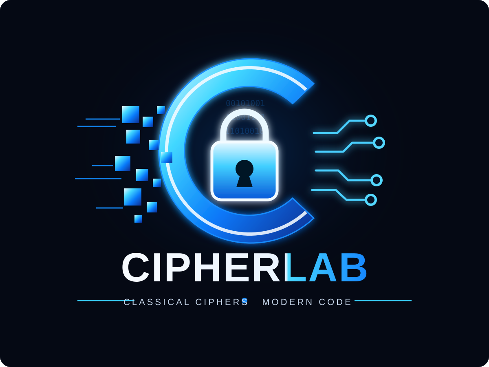

# 🔐 CipherLab

<div align="center">

```text
   ______ _       _               _          _
  / _____(_)     | |             | |        | |
 | |      _ _ __ | |__   ___ _ __| |    __ _| |__
 | |     | | '_ \\| '_ \\ / _ \\ '__| |   / _` | '_ \\
 | |_____| | |_) | | | |  __/ |  | |__| (_| | |_) |
  \\______|_| .__/|_| |_|\\___|_|  |_____\\__,_|_.__/
           | |
           |_|

       CLASSICAL CIPHERS • MODERN CODE
```

<div align="center">
  
</div>

**An interactive classical cryptography playground built with C++ and JUCE.**

[](https://isocpp.org/)
[](https://juce.com/)
[](https://cmake.org/)
[](https://www.microsoft.com/windows)
[](#)

</div>

---

CipherLab is a desktop application developed in **C++ using the JUCE framework** for the **BIS703: Information and Network Security** course. It provides an interactive environment for exploring classical encryption techniques, comparing ciphertext outputs, decrypting messages, and observing encryption execution times.

## ✨ Features

- 🔤 **Simple Substitution** — encrypt messages using a configurable 26-letter substitution alphabet.
- 🔀 **Double Transposition** — rearrange characters using row and column permutations on a rectangular matrix.
- 🔑 **One-Time Pad (OTP)** — perform letter-based encryption and decryption using modular arithmetic.
- 🔄 **Round-trip verification** — check whether decryption recovers the normalized plaintext.
- ⏱️ **Execution timing** — compare the measured encryption times of the implemented algorithms.
- 🧹 **Input normalization** — convert text to uppercase and retain only letters A–Z.
- 🖥️ **Interactive GUI** — configure keys, inspect ciphertext, and decrypt results in one application.
- 🧪 **Automated tests** — exercise cipher operations, validation, and round-trip behavior.

## 🧰 Tech Stack

| Component | Technology |
|---|---|
| Language | C++ |
| GUI framework | JUCE |
| Build system | CMake |
| Compiler | MSVC |
| Platform | Windows 10 / 11 |
| Testing | C++ test executable + CTest |

## 🔐 Cipher Showcase

| Cipher | Core operation | Key input |
|---|---|---|
| Simple Substitution | Replaces each letter using an alphabet mapping | 26-letter permutation |
| Double Transposition | Reorders a rectangular character matrix | Row and column permutations |
| One-Time Pad | Modular addition over the alphabet | Generated message-length key |

### Double Transposition example

The row and column permutations are separated by a semicolon:

```text
3,1,2;2,4,1,3
```

This example specifies a **3 × 4 matrix** and therefore requires exactly 12 normalized characters. The row and column permutations must each contain every integer from `1` to their respective lengths exactly once.

CipherLab currently requires the matrix dimensions to match the normalized message length; automatic padding and automatic dimension selection are not implemented.

## ⚙️ Quick Start

### Requirements

- Windows 10 or Windows 11
- Git
- CMake
- Visual Studio 2022 Build Tools with the **Desktop development with C++** workload
- Compatible Windows SDK

### 1. Clone the repository

```powershell
git clone https://github.com/AdityaDotEnv/CipherLab.git
cd CipherLab
git submodule update --init --recursive
```

### 2. Configure and build

```powershell
cmake -S . -B build -G "Visual Studio 17 2022" -A x64
cmake --build build --config Debug
```

### 3. Launch the application

```powershell
.\build\CipherLab_artefacts\Debug\CipherLab.exe
```

### 4. Run tests

```powershell
ctest --test-dir build -C Debug --output-on-failure
```

## 🧪 Testing

The test suite is designed to cover:

- Substitution encryption and decryption
- Invalid substitution alphabets
- Plaintext normalization
- Double Transposition round trips and permutation validation
- OTP key generation and key-length validation
- OTP encryption and decryption

Test results should be verified against the current implementation before claiming that the entire suite passes.

## 🛡️ Security Disclaimer

CipherLab is an **educational demonstration**, not a production cryptographic application.

- Simple substitution is vulnerable to frequency analysis.
- Double Transposition does not provide modern cryptographic security.
- A One-Time Pad provides perfect secrecy only if its key is truly uniformly random, independent of the plaintext, secret, at least as long as the message, and never reused.
- Generated OTP keys in this application should not be assumed to satisfy production-grade cryptographic requirements.
- Execution timings are illustrative and are not rigorous cryptographic benchmarks.

**Do not use CipherLab to protect sensitive or real-world communications.**